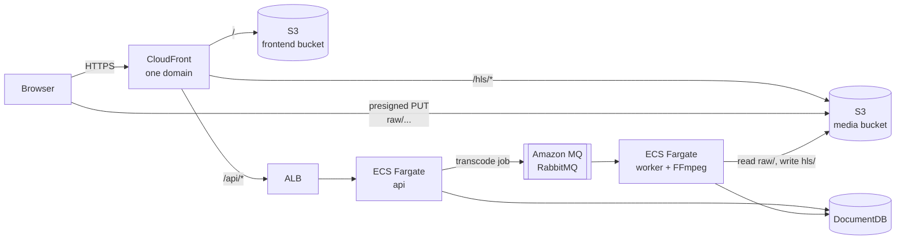
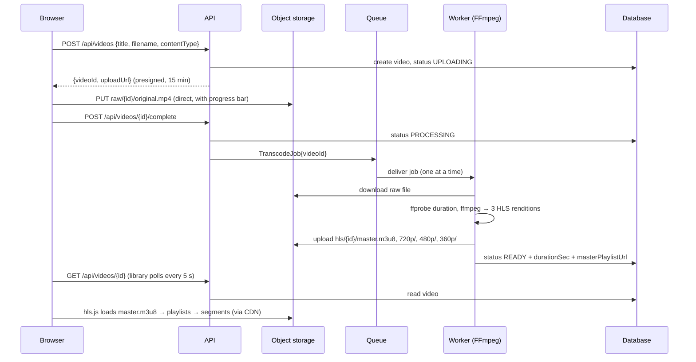

# minflix

**A small video-on-demand platform.** Users upload a video. It is transcoded into adaptive-bitrate HLS (720p / 480p / 360p), and they watch it in the browser with a quality selector, much like the big streaming services do.

The main pieces of a production VOD pipeline are all here, scaled down so each one is easy to see:
direct-to-storage uploads → a job queue → an FFmpeg transcoding worker → HLS renditions → CDN delivery → an adaptive player.

The project was built **AI-first**. Claude Code wrote the code, tests and docs against written specifications, and a human set the requirements, reviewed every plan and kept control of every irreversible action. See [How it was built](#how-it-was-built-ai-first-development).

---

## At a glance

| | |
|---|---|
| **What it does** | Register/login → upload a video → it shows *Processing* → it becomes *Ready* → play it with Auto / 720p / 480p / 360p |
| **Backend** | Java 17, Spring Boot 3.5, MongoDB, RabbitMQ, FFmpeg, AWS SDK v2 (S3) |
| **Frontend** | React 18, TypeScript, Vite, hls.js |
| **Infrastructure** | Terraform on AWS: CloudFront, S3, ALB, ECS Fargate, DocumentDB, Amazon MQ, Secrets Manager |
| **Local dev** | One `docker compose up` (MongoDB, RabbitMQ, MinIO, API, worker) + `npm run dev` |
| **Status** | Full flow verified end to end in the local environment. Production Terraform is complete and validated, not yet deployed. [Details](#project-status) |

## Repository layout

```
minflix/
├── README.md            you are here: overview, architecture, rationale
├── docs/CONTRACT.md     the shared contract: API, storage layout, environments, prod env vars
├── minflix-be/          Spring Boot API + FFmpeg transcode worker (one codebase, one image)
├── minflix-fe/          React + hls.js web app
└── minflix-infra/       Terraform for production on AWS
```

The three projects are independent and coupled **only** through [`docs/CONTRACT.md`](docs/CONTRACT.md). If a project needs something from another, the contract changes first, explicitly.

| Project | Read this for |
|---|---|
| [minflix-be](minflix-be/README.md) | API, upload signing, the transcoding pipeline, the FFmpeg ladder |
| [minflix-fe](minflix-fe/README.md) | Upload with progress, library, HLS player and quality switching |
| [minflix-infra](minflix-infra/README.md) | Production topology on AWS, security, cost, deploy steps |

---

## Architecture

### Production (AWS)



### Local development

Each AWS service is swapped for a local equivalent. The application code is the same, and only configuration changes:

| Role | Local (docker compose) | Production (AWS) |
|---|---|---|
| Web app | Vite dev server `:5173` | S3 + CloudFront |
| API | Spring Boot `:8080` | ECS Fargate `api` behind an ALB |
| Transcoder | Spring Boot `worker` profile + FFmpeg | ECS Fargate `worker` |
| Object storage | MinIO | S3 (private, served through CloudFront) |
| Queue | RabbitMQ | Amazon MQ for RabbitMQ (TLS) |
| Database | MongoDB | Amazon DocumentDB (TLS) |
| Credentials | static dev keys | IAM task roles + Secrets Manager |

### The life of a video



**1. Upload.** The browser asks the API for an upload slot and gets back a short-lived **presigned URL**. It then sends the file **straight to object storage**, never through the API.

**2. Processing.** Marking the upload complete puts a job on a **durable queue**. A separate **worker** takes one job at a time and runs a **single FFmpeg pass** that produces three renditions plus a master playlist. It uploads them and marks the video `READY`.

**3. Playback.** The player (hls.js) reads the master playlist and starts on a rendition that suits the connection. It moves up or down as bandwidth changes (**adaptive bitrate**), or stays on the quality the viewer picks.

---

## Design rationale

Each decision below is the simplest one that still behaves the way a real VOD system has to.

| Decision | Why |
|---|---|
| **Presigned uploads, straight to storage** | Video files are large. Routing them through the API would tie up memory, threads and bandwidth and risk timeouts. With a presigned URL the API only signs a 15-minute permission for one object key and one content type. The browser never holds storage credentials. |
| **Queue + separate worker** | Transcoding takes minutes of CPU; an HTTP request should take milliseconds. The durable queue separates the two, survives restarts, and lets the worker scale independently of the API. The worker processes **one job at a time** (prefetch 1) because FFmpeg already uses every core. |
| **Failed jobs are not redelivered** | A broken input would otherwise loop forever. The worker catches the failure once, marks the video `FAILED` and acknowledges the message. |
| **HLS with a 3-rung ladder** | HLS is plain HTTP files, so it caches on any CDN and plays everywhere (natively on Apple devices, through hls.js elsewhere). Ladder: 720p @ 2.8 Mbps, 480p @ 1.4 Mbps, 360p @ 0.8 Mbps, AAC 128 kbps. |
| **One FFmpeg command, aligned keyframes** | Decoding once and splitting into three scaled outputs saves CPU. A keyframe is forced every 6 s, so segments are exactly 6 s and line up across renditions, and the player can switch quality at any segment boundary without a glitch. |
| **One CloudFront domain for app, API and video** | The web app calls `/api/...` with relative URLs, so production needs no API CORS and no hostnames in the frontend build. The buckets stay private: CloudFront reads them through Origin Access Control, and only the `hls/` prefix is exposed. Raw uploads are never publicly readable. |
| **One codebase, one image, two roles** | The API and the worker share the domain model and storage code. A Spring profile (`worker`) switches a container into transcoder mode, so there is one build, one image and no code drift. |
| **Contract-first repositories** | Backend, frontend and infrastructure only agree on `docs/CONTRACT.md` (endpoints, storage layout, env vars). Each can change freely behind it, and mismatches show up during review, not in production. |
| **Same code in dev and prod** | MinIO, RabbitMQ and MongoDB locally; S3, Amazon MQ and DocumentDB in AWS. Only configuration differs. Production config has **no defaults**, so a missing setting stops startup instead of failing quietly later. |
| **Managed AWS services, no NAT gateway** | Database and broker are managed and live in private subnets with no internet route. Fargate tasks get public IPs (with no inbound access except ALB → API), which avoids an always-on NAT gateway. IAM task roles replace access keys entirely. |

### Deliberately out of scope (for now)

DRM and signed playback URLs, thumbnails, subtitles, autoscaling, a custom domain, CI/CD and automated test suites. These are the obvious next steps (see the roadmap below), but each one would make the core pipeline harder to read.

---

## Roadmap: nice to have

**Streaming quality**
- **CMAF / fMP4 segments + DASH manifests:** one set of segments for HLS and DASH, wider device reach.
- **HEVC / AV1 renditions:** the same quality at a noticeably lower bitrate on devices that support it.
- **Per-title encoding:** pick the ladder from content complexity instead of a fixed set of bitrates.
- **Thumbnails and trick-play sprites:** library posters and seek-bar previews.
- **WebVTT subtitles and multiple audio tracks:** accessibility and localization.

**Content protection**
- **Signed CloudFront URLs or cookies for `/hls/*`:** only authorized viewers can fetch segments.
- **DRM (Widevine / FairPlay / PlayReady via SPEKE):** needed for licensed content.

**Processing at scale**
- **Autoscale workers on queue depth, run on Fargate Spot:** pay for encoding only while there is work.
- **Segment-parallel encoding, or AWS Elemental MediaConvert:** faster turnaround for long videos.
- **Retry for transient failures + a dead-letter queue:** keep the never-loop guarantee while recovering from network blips.

**Upload**
- **S3 multipart / resumable uploads:** large files survive flaky connections.
- **Validate input with ffprobe before accepting it:** reject non-video or audio-less files early.
- **S3 event notification instead of the explicit `complete` call:** one less client step.

**Viewer experience**
- **Push status changes (Server-Sent Events / WebSocket):** replaces the 5-second polling.
- **Resume from last position, search, posters in the library.**

**Observability and QoE**
- **Player metrics:** startup time, rebuffering ratio, bitrate switches.
- **Platform metrics:** structured logs, metrics, tracing, and alarms on queue age and failed jobs.

**Platform and delivery**
- **CI/CD (GitHub Actions with OIDC to AWS):** build, scan and push images, then plan/apply Terraform with review.
- **Remote Terraform state with locking; custom domain + ACM certificate; WAF.**
- **Origin-secret header and HTTPS between CloudFront and the ALB.**

**Testing**
- **Backend:** Testcontainers integration tests (MongoDB, RabbitMQ, MinIO, FFmpeg).
- **Frontend:** Playwright end-to-end tests, including real playback and quality switching.
- **Load:** a load test of the upload → transcode path.

---

## How it was built: AI-first development

Every line of code, configuration and documentation here was written by an AI coding agent (**Claude Code**), working against written specifications. The human role was product owner and reviewer: defining requirements, approving plans, judging trade-offs and running anything irreversible.

**The workflow**

1. **Specs before code.** [`docs/CONTRACT.md`](docs/CONTRACT.md) defines the interfaces between the projects. Each project has a `CLAUDE.md` with its stack, requirements and engineering rules: minimal code, no speculative abstractions, validate only what the contract requires, never claim something works without running it.
2. **Plan, then approval.** For each project the agent first produced a plan with the full file list and build order. No code was written until a human approved it.
3. **Small steps, verified each time.** The agent built in fixed increments and checked after every one: compile and run against the real local stack with `curl` for the backend, type-check, build and drive a real browser for the frontend, `terraform fmt` + `terraform validate` for infrastructure.
4. **Decisions are written down.** Every assumption or deviation from the spec gets one line in the project's `docs/decisions.md`, so a reviewer can audit why, not just what.
5. **Humans keep the irreversible actions.** The agent never runs `terraform apply`/`destroy`, never pushes images and never changes cloud resources. Those steps are documented for a person to run.

**What verification caught.** Testing each step against real systems surfaced issues that reading the spec alone would have missed:

- **The quality selector would have vanished in Chrome.** The spec said "use native HLS if the browser reports support". Chrome 154 now reports support, which would have bypassed hls.js and removed the quality menu. Found in a real browser session; the player now prefers hls.js and keeps native playback only as a fallback.
- **CloudFront error pages would have broken the API.** The spec asked for distribution-wide "403/404 → index.html" rules for client-side routing. Those rules would also have turned the API's `403 Forbidden` and `404 Not found` into `200 OK` HTML. Replaced with a CloudFront Function scoped to the web-app paths only.
- **The worker crashed on startup.** It runs without a web server, so the security configuration had nothing to attach to. Found when the container first ran; fixed by making that bean web-only.
- **Broken upstream images.** The official MinIO images could no longer be pulled, and the `mongo:7` tag had an empty entrypoint script. Both were pinned to working images and the choice was recorded.
- **A known router vulnerability.** `npm audit` flagged an open-redirect advisory in react-router 6, so the app moved to the patched 7.x line, which keeps the same API.

The result is a codebase that is deliberately small and plain. Each project's `docs/decisions.md` lists every judgment call made along the way.

---

## Quick start (local)

Prerequisites: Docker (with compose), Node 20+, optionally JDK 17.

```bash
# 1. Backend + infrastructure: MongoDB, RabbitMQ, MinIO, API, worker
cd minflix-be
docker compose up --build

# 2. Web app
cd ../minflix-fe
npm install
npm run dev            # open http://localhost:5173
```

Register, upload a short video **with an audio track**, and wait a few seconds for *Processing* to become *Ready*. Then play it and switch qualities.

For a terminal-only walkthrough (register → upload → transcode → fetch the playlist with `curl`), see the [backend quickstart](minflix-be/README.md#quickstart-60-seconds-with-curl). Production deployment is covered in [minflix-infra/docs/deploy.md](minflix-infra/docs/deploy.md).

---

## Project status

| Area | Status |
|---|---|
| Backend API (auth, videos, presigned upload, owner checks, error format) | **Verified** against the local stack with `curl`, including error cases |
| Transcoding (3 renditions, master playlist, 6 s aligned segments, correct content types, failure path) | **Verified** end to end locally |
| Frontend build, type safety, production build using relative API paths | **Verified** (`tsc`, `vite build`, bundle inspection) |
| HLS player (rendition list, Auto, manual switch, "Auto (720p)" label) | **Verified** in Chrome against a public multi-bitrate test stream |
| Frontend pages against the live backend (login, library polling, upload progress) | Not yet run together; manual checklist in [minflix-fe](minflix-fe/README.md#manual-test-checklist) |
| Production infrastructure (Terraform) | **Validated** (`fmt`, `validate`, contract cross-check). **Not yet applied** to an AWS account |
| Safari / iOS native playback | Not yet tested |
