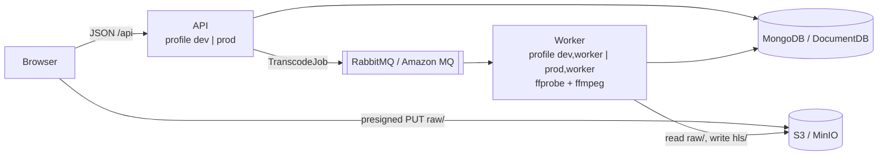

# minflix-be

The backend of [minflix](../README.md), a small video-on-demand platform. One Spring Boot codebase runs in two roles:

- **API.** Accounts and JWT auth, video metadata, presigned upload URLs, publishing transcode jobs.
- **Transcode worker.** Consumes jobs, runs FFmpeg, publishes HLS renditions to object storage.

Both roles ship as **one Docker image**. A Spring profile picks the role.



Built AI-first with Claude Code from a written spec ([`CLAUDE.md`](CLAUDE.md)) and the shared [`contract`](../docs/CONTRACT.md); see [How it was built](../README.md#how-it-was-built-ai-first-development).

## Stack

| | |
|---|---|
| Language / framework | Java 17, Spring Boot 3.5 (Web, Security, Data MongoDB, AMQP, Actuator) |
| Auth | Stateless JWT (HS256, jjwt), BCrypt password hashes |
| Storage | AWS SDK v2: S3 client + S3 presigner (MinIO in dev, S3 in prod) |
| Queue | RabbitMQ via Spring AMQP, JSON messages |
| Transcoding | FFmpeg / ffprobe via `ProcessBuilder` (no wrapper library) |
| Build / run | Maven wrapper, multi-stage Dockerfile (JDK 17 build → JRE 17 + FFmpeg) |
| Local infra | docker compose: MongoDB, RabbitMQ, MinIO |

## API

Base path `/api`, JSON. Everything except auth requires `Authorization: Bearer <jwt>`. Errors are always `{"message": "..."}`.

| Method | Path | What it does |
|---|---|---|
| POST | `/api/auth/register` | Create account → `201 {token}` (`409` if the email exists) |
| POST | `/api/auth/login` | → `200 {token}` (`401 Invalid credentials`) |
| POST | `/api/videos` | Create video (`UPLOADING`) → `201 {videoId, uploadUrl}`: a 15-minute presigned PUT bound to the content type |
| POST | `/api/videos/{id}/complete` | Owner only: set `PROCESSING`, enqueue the transcode job |
| GET | `/api/videos` | All `READY` videos + the caller's own in any status, newest first |
| GET | `/api/videos/{id}` | One video (`404` if missing or someone else's unfinished video) |
| GET | `/actuator/health` | `{"status":"UP"}`, public (load-balancer health check) |

Real request/response examples: [docs/api.md](docs/api.md).

## Transcoding pipeline

1. Download `raw/{id}/original.<ext>` to a temp directory.
2. `ffprobe` reads the duration.
3. **One FFmpeg command:** decode once, `split` into three scaled branches, encode H.264 + AAC, write HLS.
4. Upload every file to `hls/{id}/...` with the correct `Content-Type` (`application/vnd.apple.mpegurl`, `video/mp2t`). CloudFront passes it through.
5. Mark `READY` with `durationSec` and `masterPlaylistUrl`. Any failure marks `FAILED`, and the job is acknowledged so it is never redelivered in a loop.

| Rendition | Resolution | Video | Audio |
|---|---|---|---|
| 720p | 1280×720 | 2800 kbps | AAC 128 kbps |
| 480p | 854×480 | 1400 kbps | AAC 128 kbps |
| 360p | 640×360 | 800 kbps | AAC 128 kbps |

A keyframe every 6 s gives 6 s segments aligned across renditions, so the player can switch quality cleanly. The listener processes one job at a time per worker (concurrency 1, prefetch 1), because FFmpeg already saturates the CPU. Every flag is explained in [docs/transcoding.md](docs/transcoding.md).

Output layout:
```
hls/{id}/master.m3u8
hls/{id}/720p/index.m3u8, seg0.ts, seg1.ts, ...
hls/{id}/480p/...
hls/{id}/360p/...
```

## Configuration: one image, two environments, two roles

| Profile | Meaning |
|---|---|
| `dev` | `application-dev.yml`: local MongoDB, RabbitMQ, MinIO with fixed dev values |
| `prod` | `application-prod.yml`: **every** value from env vars, **no defaults**, so a missing value stops startup |
| `worker` | Added to either: enables the queue listener and transcoder. Run with `SPRING_MAIN_WEB_APPLICATION_TYPE=none` (no web server) |

Production gets its settings from ECS (provisioned by [minflix-infra](../minflix-infra/README.md)): DocumentDB over TLS (the AWS CA bundle is in the image), Amazon MQ over AMQPS, and S3 through the ECS task role, with no access keys. Full property table: [docs/configuration.md](docs/configuration.md).

## Running locally

Prerequisites: Docker with compose (and buildx for `--build`). Optional: JDK 17, plus `ffmpeg`/`ffprobe` on PATH to run the worker outside Docker.

**A. Everything in Docker**
```bash
docker compose up --build
```
**B. Infrastructure in Docker, app from the IDE/terminal**
```bash
docker compose up -d mongo rabbitmq minio minio-init
./mvnw spring-boot:run -Dspring-boot.run.profiles=dev                                               # API
SPRING_MAIN_WEB_APPLICATION_TYPE=none ./mvnw spring-boot:run -Dspring-boot.run.profiles=dev,worker  # worker
```
Health check: `curl localhost:8080/actuator/health` → `{"status":"UP"}`.

| Service | URL | Login |
|---|---|---|
| API | http://localhost:8080 | |
| MinIO console | http://localhost:9001 | `minioadmin` / `minioadmin` |
| RabbitMQ UI | http://localhost:15672 | `guest` / `guest` |
| MongoDB | `mongodb://localhost:27017/minflix` | |

## Quickstart: 60 seconds with curl

```bash
# sample video (any mp4 with an audio track works)
ffmpeg -f lavfi -i testsrc=duration=10:size=1280x720:rate=30 -f lavfi -i sine=duration=10 -c:v libx264 -c:a aac sample.mp4
# no local ffmpeg? use the app image:
# docker run --rm -v "$PWD":/w -w /w --entrypoint ffmpeg minflix-be:dev -f lavfi -i testsrc=duration=10:size=1280x720:rate=30 -f lavfi -i sine=duration=10 -c:v libx264 -c:a aac sample.mp4

TOKEN=$(curl -s -X POST localhost:8080/api/auth/register -H 'Content-Type: application/json' \
  -d '{"email":"me@x.io","password":"pw"}' | sed 's/.*"token":"\([^"]*\)".*/\1/')

RESP=$(curl -s -X POST localhost:8080/api/videos -H "Authorization: Bearer $TOKEN" -H 'Content-Type: application/json' \
  -d '{"title":"Sample","filename":"sample.mp4","contentType":"video/mp4"}')
ID=$(echo "$RESP" | sed 's/.*"videoId":"\([^"]*\)".*/\1/')
URL=$(echo "$RESP" | sed 's/.*"uploadUrl":"\([^"]*\)".*/\1/')

curl -X PUT -H 'Content-Type: video/mp4' --upload-file sample.mp4 "$URL"           # straight to storage
curl -s -X POST localhost:8080/api/videos/$ID/complete -H "Authorization: Bearer $TOKEN"

# poll until "status":"READY" (a few seconds for the sample)
curl -s localhost:8080/api/videos/$ID -H "Authorization: Bearer $TOKEN"

# the master playlist lists the 720p / 480p / 360p renditions
curl -s http://localhost:9000/minflix/hls/$ID/master.m3u8
```

## Design notes

- **Package by feature** (`auth`, `video`, `storage`, `worker`), not by layer, so each feature reads top to bottom.
- **Presigned uploads:** video bytes never pass through the API. In dev the presigner signs for `localhost:9000` (what the browser can reach), while the app itself talks to `minio:9000` inside Docker.
- **Visibility rules live in one place:** the list query and the single-video lookup share them, so another user's unfinished video is invisible either way.
- **API responses use a separate record**, so internal fields (the raw storage key) never leave the service.
- **No defaults in production config:** a misconfigured deployment fails at startup, not on the first request.
- Every assumption and deviation: [docs/decisions.md](docs/decisions.md).

## What has been verified

Against the local Docker stack:

- **Auth:** register, login, duplicate email (409), wrong password (401), missing or invalid token (401), malformed body and blank fields (400).
- **Upload:** create returns a presigned URL on `localhost:9000`. A PUT with the right content type succeeds; a wrong content type is rejected (403).
- **Transcoding:** complete → `PROCESSING` → `READY` with `durationSec: 10.0`. The master playlist lists three renditions, each with 6 s segments, served with the correct content types.
- **Access:** `raw/` objects are not publicly readable. Another user gets 403 on `complete` and 404 on unfinished videos. Listing order and visibility are correct.
- **Failure path:** completing without an upload ends in `FAILED`, and the queue drains (no redelivery).
- **CORS:** preflights from `http://localhost:5173` succeed on both the API and MinIO.
- **Prod profile:** refuses to start when an env var is missing.

**Not verified:** production connectivity (DocumentDB TLS, Amazon MQ, S3 via the task role) until it is deployed.

## Nice to have

- Testcontainers integration test of the full flow (MongoDB, RabbitMQ, MinIO, FFmpeg)
- Retry for transient failures with a dead-letter queue
- Validate uploads with `ffprobe` (and support video-only files) before queueing
- S3 multipart / resumable uploads; S3 event notifications instead of the `complete` call
- CMAF/fMP4 + DASH output, HEVC/AV1 renditions, per-title ladders, thumbnails, subtitles
- Signed playback URLs and DRM key handling
- Server-Sent Events for status changes instead of client polling
- Structured logs, metrics (queue age, encode time, failure rate) and tracing

## Documentation

| Doc | Contents |
|---|---|
| [docs/architecture.md](docs/architecture.md) | Components in dev and prod, upload/processing/watch flows, why each piece exists |
| [docs/api.md](docs/api.md) | Every endpoint with real examples and error cases |
| [docs/transcoding.md](docs/transcoding.md) | The exact FFmpeg command, each flag, the bitrate ladder |
| [docs/configuration.md](docs/configuration.md) | dev vs prod properties, where each prod env var comes from |
| [docs/local-setup.md](docs/local-setup.md) | Ports, consoles, inspecting storage/queue/DB, troubleshooting |
| [docs/decisions.md](docs/decisions.md) | Every assumption and deviation, one line each |

## Production image

Built for Fargate (x86_64) and pushed to ECR by the deployer. Deployment steps are in [minflix-infra/docs/deploy.md](../minflix-infra/docs/deploy.md).
```bash
docker buildx build --platform linux/amd64 -t <ecr-repo-url>:latest --push .
```
