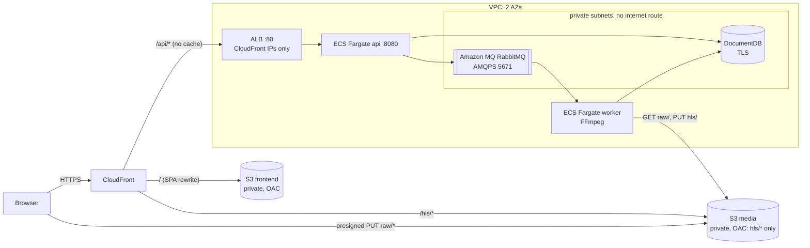

# minflix-infra

Terraform for the **production** environment of [minflix](../README.md), a small video-on-demand platform, on AWS. (Local development uses docker compose in [minflix-be](../minflix-be/README.md) and does not touch this repo.)

What production must provide (URLs, storage layout, and the env vars the backend reads) is defined in the shared [contract](../docs/CONTRACT.md).

Built AI-first with Claude Code from a written spec ([`CLAUDE.md`](CLAUDE.md)); see [How it was built](../README.md#how-it-was-built-ai-first-development). The agent writes and validates Terraform. A human runs `apply`/`destroy` and pushes images.

## Topology



## Resources and why they are there

| Resource | Purpose | Notes |
|---|---|---|
| **CloudFront** (1 distribution) | One HTTPS domain for app, API and video; edge caching of HLS segments | `/hls/*` cached, `/api/*` not cached with all viewer headers forwarded except Host; a CloudFront Function rewrites app routes (`/watch/abc`) to `index.html` |
| **S3 media bucket** | `raw/` uploads, `hls/` output | Fully private. CloudFront may read only `hls/*`. CORS allows browser PUTs from the CloudFront origin only |
| **S3 frontend bucket** | The built web app | Private, readable only by the distribution |
| **ALB** | Routes `/api/*` to the API tasks, health-checks `/actuator/health` | Security group admits only CloudFront's origin-facing IP ranges |
| **ECS Fargate `api`** | Spring Boot API | 0.5 vCPU / 1 GB by default |
| **ECS Fargate `worker`** | FFmpeg transcoder (same image, worker profile) | 2 vCPU / 4 GB / 50 GiB disk by default, no inbound traffic |
| **DocumentDB** | Users and video metadata | Private subnets, encrypted, TLS required |
| **Amazon MQ for RabbitMQ** | Durable `transcode` queue | Private subnet, AMQPS only |
| **Secrets Manager** | MongoDB URI, broker password, JWT key | Generated by Terraform (`random_password`), injected by ECS |
| **ECR** | `minflix-be` image | x86_64 (`linux/amd64`) |
| **IAM** | Execution role + one task role per service | Least privilege: api may only `PutObject raw/*`; worker may `GetObject raw/*` and `PutObject hls/*` |
| **CloudWatch Logs** | One log group per service | 14-day retention |

## Security posture

- **No public buckets.** Both buckets block all public access. Video reaches viewers only through CloudFront (Origin Access Control), and only from `hls/`. Raw uploads are never publicly readable.
- **Layered network access.** CloudFront → ALB (CloudFront IP ranges only) → API (from the ALB only). The database and broker sit in private subnets with no internet route and accept traffic only from the ECS tasks.
- **No long-lived credentials.** Tasks use IAM roles. Secrets live in Secrets Manager and are injected at task start. No access keys exist anywhere in code or config.
- **TLS everywhere it leaves the browser:** HTTPS at CloudFront, TLS to DocumentDB, AMQPS to the broker. The CloudFront → ALB hop is HTTP inside AWS; see the roadmap.
- **No secrets in git.** `terraform.tfvars` and state are gitignored, and generated values exist only in state and Secrets Manager.

## Inputs and outputs

All variables have defaults ([variables.tf](variables.tf)). Override them by copying [terraform.tfvars.example](terraform.tfvars.example) to `terraform.tfvars`.

| Variable | Default |
|---|---|
| `region` | `ap-southeast-1` |
| `image_tag` | `latest` |
| `api_cpu` / `api_memory` | 512 / 1024 |
| `worker_cpu` / `worker_memory` / `worker_ephemeral_storage_gib` | 2048 / 4096 / 50 |
| `docdb_instance_class` | `db.t3.medium` |
| `mq_instance_type` | `mq.t3.micro` |
| `cloudfront_price_class` | `PriceClass_200` |
| `api_desired_count` / `worker_desired_count` | 1 / 1 |

Outputs: `cloudfront_domain`, `cloudfront_distribution_id`, `frontend_bucket`, `media_bucket`, `ecr_repository_url`, `ecs_cluster_name`, `api_service_name`, `worker_service_name`.

## Deploying

Prerequisites: Terraform ≥ 1.6 (or the `hashicorp/terraform` Docker image), AWS CLI v2 with credentials, Docker with buildx, and Node.

The first deploy is done in order:
1. Create the ECR repository.
2. Push the backend image.
3. Apply everything else.
4. Upload the frontend.
5. Run a smoke test.

The exact copy-paste commands, backend updates, logs, teardown and troubleshooting are in **[docs/deploy.md](docs/deploy.md)**.

## Cost

Everything here runs 24/7 once applied. DocumentDB, the Amazon MQ broker, the ALB and the two Fargate services dominate the bill, which is roughly a few hundred USD per month if left running. Set `worker_desired_count = 0` when idle and `terraform destroy` when the environment is not needed. Breakdown: [docs/cost.md](docs/cost.md).

## Layout

One root module, flat files by concern, local state.
```
versions.tf    Terraform/provider versions, default tags (Project=minflix, Env=prod)
variables.tf   tunables with defaults
network.tf     VPC, public/private subnets, IGW, route tables, security groups
storage.tf     media + frontend buckets
ecr.tf         image repository
secrets.tf     generated passwords, Secrets Manager secrets
database.tf    DocumentDB
mq.tf          Amazon MQ for RabbitMQ
iam.tf         execution role, api and worker task roles
alb.tf         ALB, target group, listener
ecs.tf         cluster, log groups, task definitions (contract env vars), services
cdn.tf         CloudFront, OAC, SPA function, bucket policies, media CORS
outputs.tf
```

## Status

| Check | Result |
|---|---|
| `terraform fmt -check` | Passes |
| `terraform validate` (AWS provider 5.100) | Passes |
| Dependency graph | No cycles |
| Contract cross-check | All 10 prod env vars wired (3 via Secrets Manager); all 8 values the backend's prod config reads are covered; ports and paths match the diagram |
| `terraform plan` / `apply` | **Not yet run** against an AWS account |

## Nice to have

- Remote state (S3 + locking) and CI/CD with GitHub Actions + OIDC (plan on PR, apply on approval)
- Custom domain with an ACM certificate; AWS WAF on CloudFront
- Origin-secret header (or VPC origin) and HTTPS between CloudFront and the ALB
- Signed CloudFront URLs/cookies for `/hls/*`
- Worker autoscaling on queue depth, Fargate Spot for encoding
- NAT-free private tasks via VPC endpoints (ECR, S3, Secrets Manager, Logs)
- Multi-AZ DocumentDB and an active/standby broker for higher availability
- CloudWatch alarms and dashboards (queue age, 5xx rate, task restarts)

## Documentation

| Doc | Contents |
|---|---|
| [docs/architecture.md](docs/architecture.md) | Diagram, one paragraph per component, dev → prod mapping |
| [docs/deploy.md](docs/deploy.md) | Ordered deploy steps, updates, logs, teardown, troubleshooting |
| [docs/cost.md](docs/cost.md) | Cost drivers and how to cut them |
| [docs/decisions.md](docs/decisions.md) | Every assumption and deviation, one line each |
